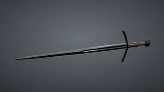
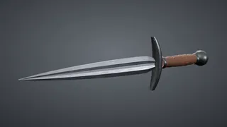
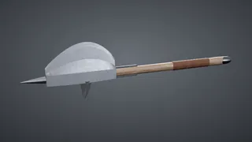
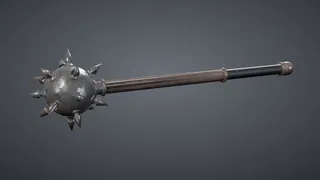
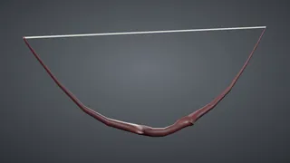
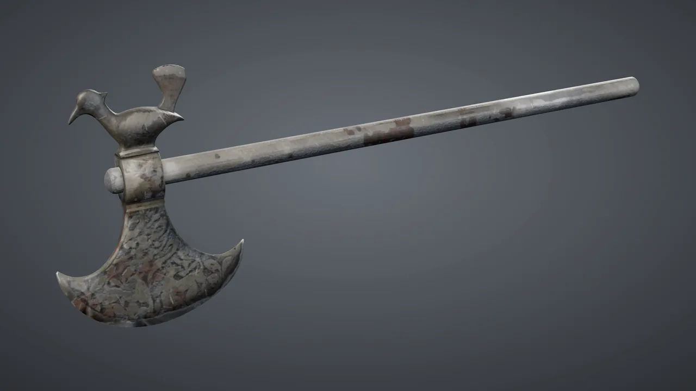
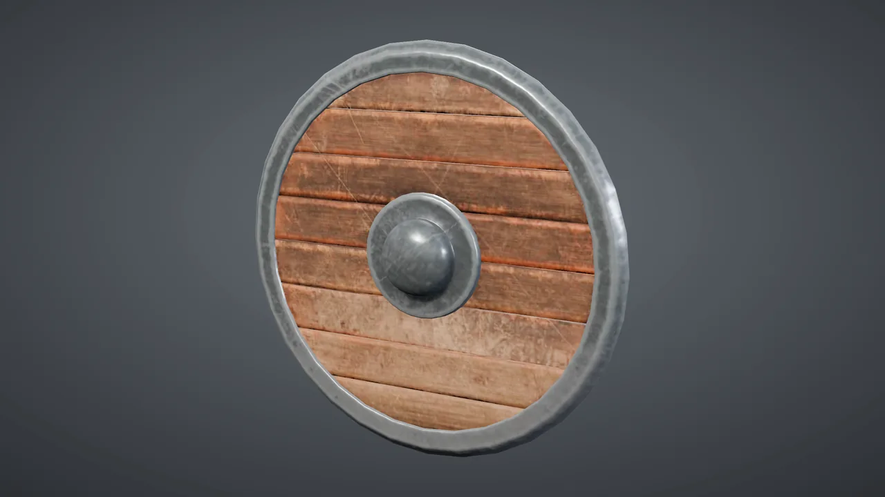
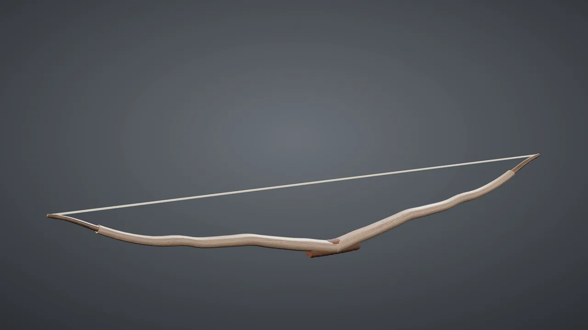
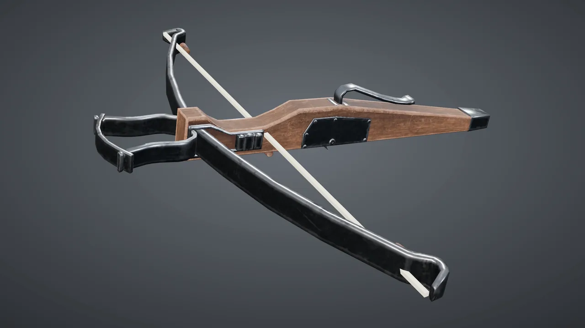

# Zee's Medieval Weapons

Ten medieval weapons for [dot-weapon](https://github.com/gamespice-platform/weapon), each with a real PBR model and its own tuned profile: a longsword, a dagger, three axes, a mace, a spear, a round shield that blocks and bashes, a bow with a real draw and a dropping arrow, and a crossbow with a slow reload and a flatter bolt. Every number below is a default read straight from the pack's data, and every one can be changed per game or per server without touching the pack. Made for Zombie Zone, usable in any game or server (`provides.json`, kind `weapon`, games `*`). The addon is `addons/zz_medieval_weapons`.

### In GameSpice and Fatal Contact

- **GameSpice:** the pack is published to the Workshop as `zz-medieval-weapons`. Add it to a server's or game's pack list and its weapons appear in the spawn menu under Melee, Shields and Ranged; players get it with the server's pack overlay, so there is nothing to install.
- **Fatal Contact:** add `zz_medieval_weapons` to `weapons.packs` in `cfg/addon/game_arena_weapons/*.yml`. Its weapons join the catalogue after the game's own (see Fatal Contact's `docs/weapons.md`).
- **Your own Godot game:** link or copy `addons/zz_medieval_weapons` beside dot-weapon and use the code in [Using it](#using-it).

Stamina, knockback and blocking come out of the pack as events and a helper the game applies (see [Using it](#using-it)). A weapon's carry weight is in its profile.

<!-- gen_readme:summary -->
| | Weapon | Class | Damage | Rate |
| --- | --- | --- | --- | --- |
|  | [Longsword](#longsword) | Sword | 55 | 91 rpm |
|  | [Dagger](#dagger) | Dagger | 28 | 192 rpm |
|  | [Battle Axe](#battle-axe) | Axe | 80 | 55 rpm |
|  | [War Axe](#war-axe) | Axe | 72 | 62 rpm |
|  | [Double Axe](#double-axe) | Axe | 90 | 49 rpm |
|  | [Mace](#mace) | Mace | 66 | 69 rpm |
|  | [Spear](#spear) | Spear | 60 | 74 rpm |
|  | [Round Shield](#round-shield) | Shield | 14 | 69 rpm |
|  | [Bow](#bow) | Bow | 75 | 40 rpm |
|  | [Crossbow](#crossbow) | Crossbow | 90 | 18 rpm |
<!-- /gen_readme:summary -->

## Using it

- The addon is `addons/zz_medieval_weapons/`. The Workshop form is `weapons/*.tres` plus `provides.json`, generated by `tools/export-defs.sh`.
- `ZzMedievalPack.weapons()` returns the `DotWeaponDef`s. Add them to a `DotWeaponCatalogue`.
- Melee is dot-weapon's sweep of rays. The bow fires through `DotWeaponProjectile`. Stamina and knockback come out as events (`{"type": "stamina", "cost"}` and `{"type": "knockback", "impulse", "direction"}`) that the game applies.
- A raised shield is a stance. The damage path calls `ZzMedievalBlock.reduced(def, damage, facing, hit_from, blocking)` and charges `ZzMedievalBlock.stamina_cost`.
- A spawn menu calls `ZzMedievalSpawnProvider.spawn_entries()`.

The pack also draws the weapons: a first-person view with arms, a world model, swings, a shield guard and bash, a bow draw and loose, and a crossbow cocking. See [docs/view-model.md](docs/view-model.md). Metal needs something to reflect: see [docs/lighting.md](docs/lighting.md).

## Settings

Every number is in a weapon profile, `cfg/addons/zz_medieval_weapons/weapon/<id>.yml`. Common keys (`name`, `slot`, `deploy_ticks`, `holster_ticks`, `reserve`, `magazine`, `reload_ticks`, `use_interval_ticks`, `min_charge`) are at the top; this pack's keys are under `extra:`.

| Keys | Weapons | Meaning |
| --- | --- | --- |
| `damage`, `reach`, `arc_degrees`, `rays`, `swing_ticks`, `stamina_cost` | melee | Hit and swing |
| `speed`, `min_speed`, `gravity_scale`, `draw_ticks` | bow, crossbow | Projectile speed and arrow drop |
| `knockback`, `block_reduction`, `block_arc_degrees`, `block_stamina_per_damage` | shield | Bash and block |

Durations are ticks at 64 Hz. A game overrides keys in `cfg/game/<game>/weapon/<id>.yml` (set `ZzMedievalConfig.game`), a server operator in `cfg/server/weapon/<id>.yml`. Deleting a shipped file changes nothing: built-in defaults apply. A weapon with a folder may hold `upgrades/<id>.yml` (`set`, `mul`, `add`, a `cost` and `requires`), applied with `ZzMedievalConfig.upgraded(id, [ids])`.

## Testing

`./game.sh test` parses every script and runs the pack's suite. `tools/screenshot.sh [weapon ...]` renders each model to `screenshots/`.

The weapon gallery in this README is generated: `tools/gen_readme.sh` renders the studio shots on a GPU box (`tools/readme_shot.sh`, settings in `tools/readme.cfg`), turns them into `docs/img/*.webp`, and rewrites the tables from the profiles and `docs/readme/weapons.yml`. `tools/gen_readme.sh --check` fails when the README is out of date.

<!-- gen_readme:weapons -->
## The weapons

### Longsword

**Sword** `longsword`. A Type XVIa longsword, the all-rounder. Long reach, a wide cut and a quick recovery for its stamina.

| Default | |
| --- | --- |
| Damage | 55 (slash) |
| Swing rate | 91 rpm |
| Reach | 2.4 m |
| Swing arc | 60 deg |
| Stamina | 12 per swing |
| Draw time | 0.41 s |

### Dagger

**Dagger** `dagger`. The fastest swing in the pack and the cheapest on stamina. Short reach and a narrow thrust, so it rewards getting close.

| Default | |
| --- | --- |
| Damage | 28 (pierce) |
| Swing rate | 192 rpm |
| Reach | 1.4 m |
| Swing arc | 20 deg |
| Stamina | 4 per swing |
| Draw time | 0.19 s |
| Carry weight | 2 |

### Battle Axe

**Axe** `battle_axe`. A crescent-bladed battle axe. Heavy cuts with a broad arc, paid for in stamina and a slow recovery.

| Default | |
| --- | --- |
| Damage | 80 (slash) |
| Swing rate | 55 rpm |
| Reach | 2.1 m |
| Swing arc | 50 deg |
| Stamina | 22 per swing |
| Draw time | 0.53 s |
| Carry weight | 2 |

### War Axe

**Axe** `war_axe`. A decorated bearded axe, a step lighter than the battle axe. A little less damage for a quicker swing.

| Default | |
| --- | --- |
| Damage | 72 (slash) |
| Swing rate | 62 rpm |
| Reach | 2 m |
| Swing arc | 46 deg |
| Stamina | 20 per swing |
| Draw time | 0.5 s |
| Carry weight | 2 |

### Double Axe

**Axe** `double_axe`. A double-bladed long axe. The hardest hitter and the widest arc in the pack, and the slowest and most tiring swing.

| Default | |
| --- | --- |
| Damage | 90 (slash) |
| Swing rate | 49 rpm |
| Reach | 2.2 m |
| Swing arc | 70 deg |
| Stamina | 26 per swing |
| Draw time | 0.59 s |
| Carry weight | 2 |

### Mace

**Mace** `mace`. A spiked-head mace that strikes rather than cuts. A tight arc, steady damage and a mid-weight swing.

| Default | |
| --- | --- |
| Damage | 66 (strike) |
| Swing rate | 69 rpm |
| Reach | 1.9 m |
| Swing arc | 36 deg |
| Stamina | 16 per swing |
| Draw time | 0.44 s |
| Carry weight | 2 |

### Spear

**Spear** `spear`. The longest reach in the pack on a narrow thrust. Keeps a horde at arm's length if the aim is good.

| Default | |
| --- | --- |
| Damage | 60 (pierce) |
| Swing rate | 74 rpm |
| Reach | 3.3 m |
| Swing arc | 8 deg |
| Stamina | 14 per swing |
| Draw time | 0.47 s |
| Carry weight | 2 |

### Round Shield

**Shield** `round_shield`. A worn wooden round shield with an iron boss and rim. Raised, it stops most of a hit from the front for stamina; swung, it bashes and knocks the target back.

| Default | |
| --- | --- |
| Damage | 14 (strike) |
| Swing rate | 69 rpm |
| Reach | 1.7 m |
| Swing arc | 44 deg |
| Knockback | 7 impulse |
| Block | stops 80 % of a hit within 120 deg, 0.3 stamina per damage stopped |
| Stamina | 10 per swing |
| Draw time | 0.34 s |
| Carry weight | 2 |

### Bow

**Bow** `bow`. A wooden self bow. Damage and arrow speed grow with the draw, and the arrow drops over distance. Loosed early it is weak and slow.

| Default | |
| --- | --- |
| Damage | 75 (pierce) |
| Fire rate | 40 rpm at full draw |
| Projectile speed | 72 m/s (22 m/s undrawn) |
| Drop | 1 x gravity |
| Pull to full draw | 1.12 s |
| Undrawn damage | 20 % |
| Stamina | 8 per shot |
| Draw time | 0.44 s |

### Crossbow

**Crossbow** `crossbow`. A stirrup crossbow. Full power on every shot and a flatter, faster bolt than the bow, but each bolt takes a long reload.

| Default | |
| --- | --- |
| Damage | 90 (pierce) |
| Fire rate | 18 rpm with reloads |
| Magazine | 1 + 20 reserve |
| Reload | 3.12 s |
| Projectile speed | 100 m/s |
| Drop | 0.55 x gravity |
| Stamina | 6 per shot |
| Draw time | 0.47 s |
| Carry weight | 2 |
<!-- /gen_readme:weapons -->

## Credits

Every model was decimated, re-textured and given a worn look. Author, URL and change notes are in [CREDITS.md](CREDITS.md). The code is MIT, see [LICENSE](LICENSE).

| Weapon | Model | Author | Licence | Source |
| --- | --- | --- | --- | --- |
| `double_axe` | Decorative Double-Bladed Battle Axe | Arms Museum | CC0 1.0 | [link](https://sketchfab.com/3d-models/decorative-double-bladed-battle-axe-f0bfbca7a2804efd9cf77fd0f5a806aa) |
| `war_axe` | Decorative Battle Axe | Arms Museum | CC0 1.0 | [link](https://sketchfab.com/3d-models/decorative-battle-axe-97575b982f5944baa0c9062d8107a983) |
| `longsword` | Medieval Longsword Type XVIa | leeeck | CC BY 4.0 | [link](https://sketchfab.com/3d-models/359b73c3e8c449d7aa5fd96e7d831abd) |
| `bow` | Medieval Bow and Arrow | ana.stakflett | CC BY 4.0 | [link](https://sketchfab.com/3d-models/d5680d6d851d4411941f8f40f7feab94) |
| `round_shield` | Worn Round Shield | iedalton | CC BY 4.0 | [link](https://sketchfab.com/3d-models/d848db788bc041ddab8a51c7836979d2) |
| `battle_axe` | Medieval Battle Axe | CaptainHC | CC BY 4.0 | [link](https://sketchfab.com/3d-models/79115d20afec46928ca10dd948b4ced6) |
| `mace` | Medieval Mace | Kama Modeling | CC BY 4.0 | [link](https://sketchfab.com/3d-models/83217215a0c541b2956a8e87a4ae62fe) |
| `spear` | Medieval Spear | iedalton | CC BY 4.0 | [link](https://sketchfab.com/3d-models/f61070945153418fa11c4abae286b292) |
| `crossbow` | Medieval Crossbow | iedalton | CC BY 4.0 | [link](https://sketchfab.com/3d-models/cc36ed347db340d59bd2ec7b06ae0d63) |
| `dagger` | Medieval Dagger | Whatevvs | CC BY 4.0 | [link](https://sketchfab.com/3d-models/519b1fc1390747038cfc9f4ea158f660) |
